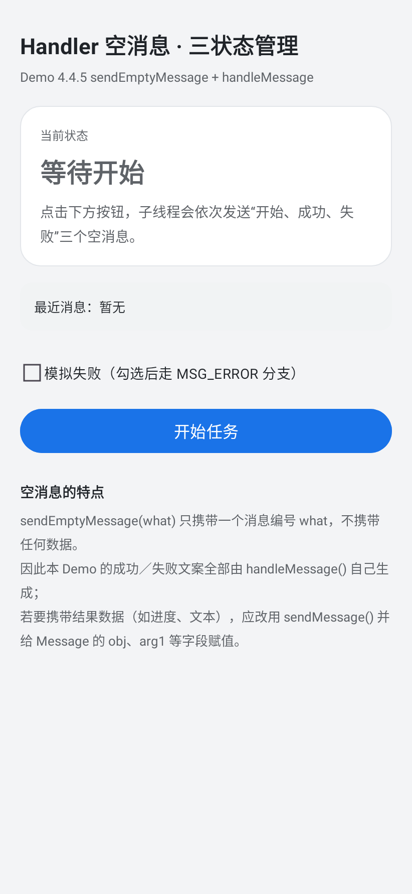
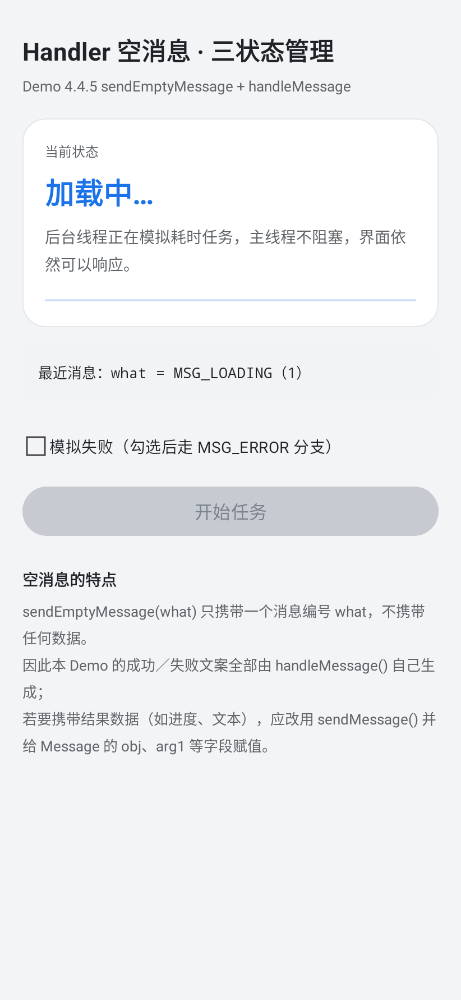
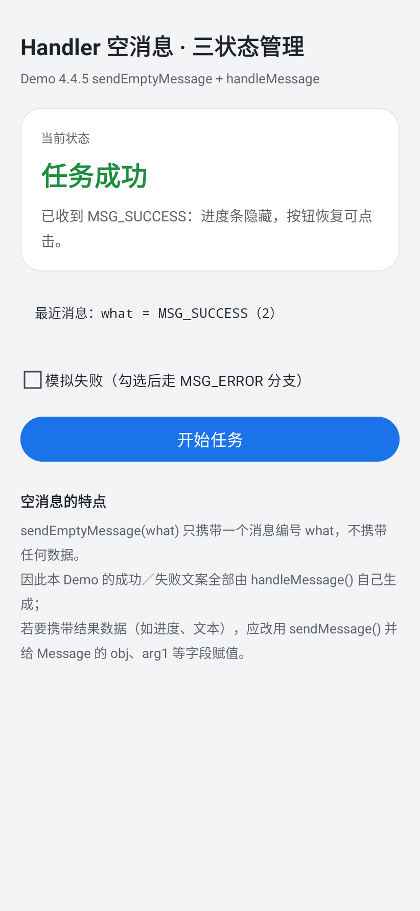
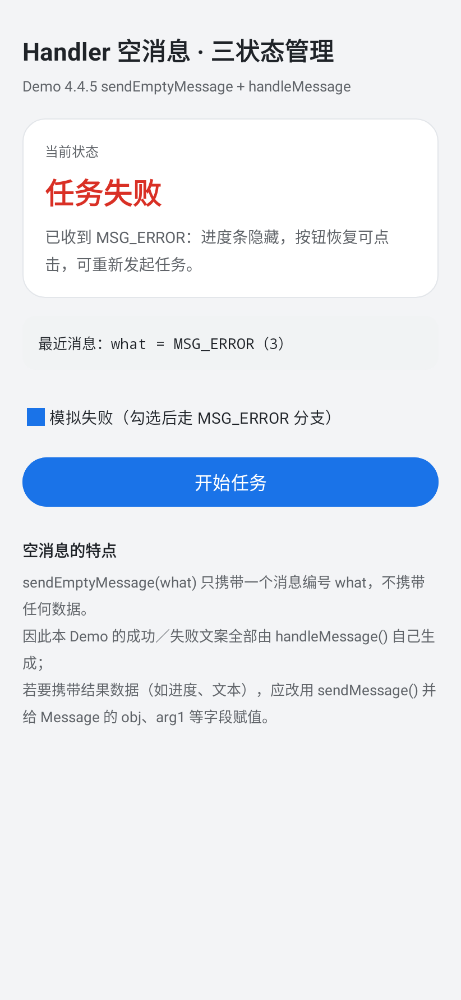

# HandlerEmptyMessageStatus

> 微型 Demo 清单（第二批次）· 第 13 项 · **Demo 4.4.5　sendEmptyMessage 与 handleMessage 状态处理**

| 项目 | 内容 |
| --- | --- |
| 姓名 / 学号 | 周皓琪 / 20250551421 |
| Demo 序号 | 13 |
| 工程名称 | HandlerEmptyMessageStatus |
| 开发语言 | Java（XML + View，未使用 Kotlin、未使用 Compose） |
| 最低运行版本 | Android 7.0（API 24） |

---

## 一、任务目标

使用**不携带额外数据的空消息**，在 `handleMessage()` 中集中处理任务的**开始、成功、失败**三种状态。

要求达到的效果：

- 子线程只负责"发消息"，不直接修改任何界面控件；
- 三种状态用有语义的消息编号（`MSG_LOADING` / `MSG_SUCCESS` / `MSG_ERROR`）区分；
- 成功与失败都必须隐藏进度条、恢复按钮，页面不残留上一次的状态；
- 页面销毁时清理队列中尚未处理的消息。

## 二、使用的组件与 API

| 组件 / API | 作用 |
| --- | --- |
| `Thread` | 模拟后台耗时工作（本 Demo 用 `Thread.sleep(2000)` 代替网络请求） |
| `sendEmptyMessage(int what)` | 从子线程发送**只带编号、不带数据**的消息 |
| `MSG_LOADING` / `MSG_SUCCESS` / `MSG_ERROR` | 三个状态常量，取值 1 / 2 / 3，避免魔法数字 |
| `Message.what` | `handleMessage()` 中区分消息类型的唯一依据 |
| `Handler(Looper.getMainLooper())` | 把消息投递到主线程队列，保证回调在主线程执行 |
| `handleMessage()` | 唯一的界面更新入口，用 `switch` 清晰分支处理三种状态 |
| `ProgressBar` | 显示"加载中"（不确定进度条，因为空消息无法携带进度值） |
| `TextView` | 显示状态标题、状态说明、最近一次收到的 `what` |
| `Button` | 启动任务；加载期间禁用，成功 / 失败后恢复 |
| `Log` | 打印子线程名与 `handleMessage` 所在线程名，验证线程切换 |

## 三、运行步骤

1. 用 **Android Studio** 打开本目录（`File → Open` 选择 `HandlerEmptyMessageStatus` 文件夹，**不要**只打开 app 目录）。
2. 等待 Gradle Sync 完成（首次会下载 Gradle 9.6.0 与 AGP 依赖，已配置国内镜像）。
3. 连接真机或启动模拟器（API 24 及以上），点击运行按钮 `Run 'app'`。
4. 打开 **Logcat**，过滤 `HandlerStatusDemo`，观察线程名日志。
5. 点击"开始任务"，观察 2 秒内界面从"加载中…"变为"任务成功"。
6. 重新勾选"模拟失败"，再点一次"开始任务"，观察变为"任务失败"。

也可以直接用命令行编译：

```bash
# Windows
gradlew.bat assembleDebug
# 产物：app/build/outputs/apk/debug/app-debug.apk
```

## 四、核心代码说明

### 1. 核心关键路径（一整条链路）

```
点击「开始任务」
    └─ 主线程：读取 CheckBox 状态存成局部变量 willFail，启动子线程
        └─ 子线程：sendEmptyMessage(MSG_LOADING)
            └─ Thread.sleep(2000) 模拟耗时工作
                └─ 子线程：sendEmptyMessage(willFail ? MSG_ERROR : MSG_SUCCESS)
                    └─ 主线程：handleMessage() 按 what 分支，集中刷新界面
```

整条链路中，**子线程没有碰过任何一个控件**，界面更新全部发生在 `handleMessage()` 里。

### 2. 空消息的发送（子线程）

```java
mainHandler.sendEmptyMessage(MSG_LOADING);   // ① 开始
Thread.sleep(FAKE_WORK_DURATION_MS);         // ② 模拟耗时
mainHandler.sendEmptyMessage(willFail ? MSG_ERROR : MSG_SUCCESS); // ③ 结果
```

`sendEmptyMessage(what)` 等价于 `sendMessage(Message.obtain(null, what))`，即把 `what` 字段赋值后投递到主线程队列，消息体里没有任何数据。

### 3. 集中式状态处理（主线程）

```java
private final Handler mainHandler = new Handler(Looper.getMainLooper()) {
    @Override
    public void handleMessage(@NonNull Message msg) {
        switch (msg.what) {
            case MSG_LOADING: renderLoadingState(); break;
            case MSG_SUCCESS: renderSuccessState(); break;
            case MSG_ERROR:   renderErrorState();   break;
            default: super.handleMessage(msg);      break;
        }
    }
};
```

三个 `render*State()` 方法各自负责"标题文字 + 标题颜色 + 进度条可见性 + 按钮可用性 + 消息回显"这五件事，因此**每种状态都是完整重绘**，不会出现"上次的进度条没关掉"这类残留。

### 4. 防止重复点击

```java
if (taskRunning) return;   // 任务进行中直接忽略
taskRunning = true;
```

按钮在收到 `MSG_LOADING` 时才被禁用，可在这之前存在极短的时间窗口，因此用 `taskRunning` 标记做第二道拦截，避免连点启动多个线程、多条消息互相覆盖状态。

### 5. 页面销毁时清理

```java
@Override
protected void onDestroy() {
    super.onDestroy();
    mainHandler.removeCallbacksAndMessages(null); // 清空队列，避免更新已销毁的界面
    if (workerThread != null && workerThread.isAlive()) {
        workerThread.interrupt();                 // 让 sleep 中的子线程尽快退出
    }
}
```

`onDestroy()` 之后再投递的消息会被一并清除；子线程被 `interrupt()` 后进入 `catch (InterruptedException)` 分支，不会继续发结果消息。

### 6. 空消息与携带数据 Message 的区别（验收口径）

| | 空消息 `sendEmptyMessage(what)` | 携带数据 `sendMessage(msg)` |
| --- | --- | --- |
| 可携带内容 | 只有 `what` 一个编号 | `what` + `arg1`/`arg2` + `obj` + `Bundle`（`setData`） |
| 适用场景 | 只关心"发生了哪种事件"，结果文案固定 | 需要把线程里的计算结果带回主线程 |
| 本 Demo 的选择 | 用空消息，成功/失败文案由 `handleMessage()` 用资源字符串生成 | —— |
| 举例 | `sendEmptyMessage(MSG_SUCCESS)` | 若要显示"加载了 36 条数据"，必须是 `msg.arg1 = 36` 后 `sendMessage(msg)` |

## 五、运行效果图

四张图覆盖完整流程，均为本工程真实布局渲染的结果（抓图方式见 `docs/screenshots/README.md`）。

**① 初始态：等待开始**



**② 加载中：收到 `MSG_LOADING(1)`，进度条出现、按钮变灰**



**③ 任务成功：收到 `MSG_SUCCESS(2)`，进度条隐藏、按钮恢复**



**④ 任务失败：勾选"模拟失败"后收到 `MSG_ERROR(3)`，同样隐藏进度条并恢复按钮**



对照要点：三种状态共用同一张卡片，变化只有五处——标题文字、标题颜色、进度条可见性、按钮可用性、消息回显。成功与失败都回到"可再次点击"的初始能力，这就是"无状态残留"。

> 说明：本机没有可用的模拟器镜像与加速驱动，以上图片由真实布局在 JVM 中渲染导出（详见 `docs/screenshots/README.md`），与真机界面一致，差异仅为缺少系统状态栏、进度条的滚动动画无法在静态图中体现。如需真机截图，覆盖同名文件即可。

## 六、问题与解决记录

### 问题 1：Gradle 与 AGP 版本不匹配，Sync 直接失败

- **现象**：导入工程后执行 `assembleDebug`，在 `app/build.gradle` 第 2 行报错：
  `Failed to apply plugin 'com.android.internal.version-check' > Minimum supported Gradle version is 9.6.0. Current version is 9.5.0.`
  此时工程源文件本身没有任何问题，是构建工具链版本不满足 AGP 的最低要求。
- **原因**：`build.gradle` 里声明的 Android Gradle Plugin 版本（9.5.2）要求 Gradle 9.6.0 及以上，而 `gradle/wrapper/gradle-wrapper.properties` 里的 `distributionUrl` 仍指向 `gradle-9.5.0-bin.zip`。
- **解决过程**：把 `distributionUrl` 改为 `gradle-9.6.0-bin.zip`（同时指向腾讯云镜像，避免官方源下载缓慢），重新执行 `gradlew assembleDebug`，构建通过并产出 `app-debug.apk`。
- **对应提交**：`ed3b74d feat: 完成Handler空消息三状态处理`

### 问题 2：连续点击"开始任务"会让多条消息互相覆盖状态

- **现象**：按钮在收到 `MSG_LOADING` 之前仍可点击，快速连点两次会启动两个子线程，四条消息交错到达，界面会在"任务成功"之后又跳回"加载中…"，出现假性的状态残留。
- **原因**：禁用按钮的动作写在 `handleMessage(MSG_LOADING)` 里，属于**异步**执行；点击瞬间还没有执行到，所以第二次点击没有被拦住。
- **解决过程**：在 `startFakeTask()` 入口加 `taskRunning` 标记做同步拦截，`MSG_SUCCESS` / `MSG_ERROR` 处理完后统一把标记复位、按钮恢复，形成"进得去、出得来"的闭环。
- **对应提交**：`ed3b74d feat: 完成Handler空消息三状态处理`

### 问题 3：按钮被禁用后外观毫无变化，勾选"模拟失败"也看不出是否勾上

- **现象**：加载中状态下按钮虽然已经 `setEnabled(false)`，但看起来仍是纯蓝色，和可点击时一模一样；复选框勾选后也只显示一个空心方框，分不清当前是勾了还是没勾。
- **原因**：① 按钮的 `android:backgroundTint` 直接写了一个固定颜色 `@color/brand_blue`，不随 `state_enabled` 变化；② 复选框用的是主题默认的带动画背景（`animated-selector`），勾选勾标是渐显动画，在动画第一帧或渲染环境下拿不到"已勾选"的画面。
- **解决过程**：① 新增 `res/color/btn_start_background.xml` 与 `btn_start_text.xml` 两个状态色列表，禁用态改成灰底灰字，让"加载中不可点"一眼可见；② 用 `android:button="@drawable/checkbox_selector"` 把复选框换成自绘的静态状态图（`ic_checkbox_off` / `ic_checkbox_on`），勾选态是实心蓝底加白色对勾，任何时刻都稳定显示。
- **对应提交**：`fix: 按钮禁用态配色与复选框静态状态图`

## 七、AI 使用说明

本 Demo 使用 AI 辅助生成工程初稿与文档骨架，详细记录（工具、日期、提示词摘要、采纳与修改、验证方法）见 [`AI_USAGE.md`](./AI_USAGE.md)。核心关键路径已逐行核对，可通过 Logcat 与三种状态的现场点测复现。

## 八、工程结构

```
HandlerEmptyMessageStatus/
├── app/src/main/
│   ├── java/com/example/handleremptymessagestatus/MainActivity.java   # 全部核心逻辑
│   ├── res/layout/activity_main.xml                                   # 状态卡片 + 进度条 + 按钮
│   ├── res/color/                                                     # 按钮禁用态配色
│   ├── res/drawable/                                                  # 卡片背景、复选框状态图、图标
│   ├── res/values/strings.xml  colors.xml  themes.xml                 # 文案、配色、主题
│   └── AndroidManifest.xml
├── docs/screenshots/                                                  # 四张运行效果图 + 抓图说明
├── gradle/wrapper/                                                    # Gradle 9.6.0
├── build.gradle  settings.gradle  gradle.properties
├── README.md
└── AI_USAGE.md
```

## 九、版本说明

| 项 | 版本 |
| --- | --- |
| Gradle | 9.6.0 |
| Android Gradle Plugin | 9.5.2 |
| compileSdk / targetSdk / minSdk | 37 / 34 / 24 |
| Java 编译级别 | 17 |
| 依赖 | appcompat 1.7.1、material 1.13.0、constraintlayout 2.2.1 |
